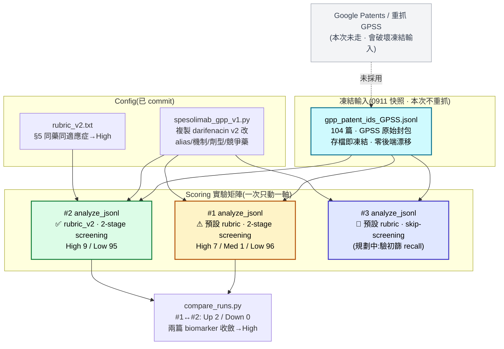

# Spesolimab × GPP Scoring 驗證 — 開發版流程報告

開發流程紀錄,非交付物。標的:GPP × **Spesolimab**(positive control / scoring 邏輯驗證,非 FTO)。
數字快照:2026-09-14。延續 0911 GPSS pipeline,主角由 darifenacin 換成 spesolimab。

---

## 本次分析流程(scoring 實驗框架)

> 標註重點:**哪一步用哪個 rubric / screening**。這是 scoring 調校實驗,不是真 FTO memo——
> spesolimab 是已上市 GPP 原研藥(Spevigo, anti-IL-36R mAb),天生該有大量 high-risk 在先技術,
> 拿來當**已知陽性**檢查 scoring 會不會正確抬 risk。輸入集為 **0911 凍結快照**,本次不重抓。



對照 HS production flow:HS 是 Pass 1 EPO → Pass 2 GPSS 的完整兩段抓取;**本次是其子集**——
直接從 0911 已抓好的 GPSS JSONL 起跑,只做 Pass 2 的 `analyze_jsonl`,目的是調 scoring 而非建 landscape。
故無 EPO fetch、無 GPSS 重抓、無三藥 `--resume` 併檔。

---

## 1. 實作流程

### 凍結輸入(關鍵差異:不重抓)

```
gpss-probe/test_0911/gpp_patent_ids_GPSS.jsonl   # 104 篇,0911 存檔即凍結
```

- pipeline 凍結點在中間:`[0911 GPSS 抓取] → JSONL(凍結) → [analyze_jsonl 只讀此檔]`。
- GPSS 後端更新**只影響重抓**;沿用既有檔零漂移。此檔是整條重現鏈唯一需保管的輸入。
- spesolimab 在 5×3 matrix 中為**原生成員**(14 篇命中,含 3 篇 granted B2),天然避開 0911
  待探索 A 的「輸入集盲點」——這正是它適合當 positive control、而 darifenacin(對照空格)不適合的原因。

### analyze_jsonl(scoring 實驗 · 半自動)

每個 cell 換旗標 + prefix 後跑,`_flatten_gpss_envelope` 攤平 GPSS wrapper → flat 欄位(0911 commit `ca830f3`)。

| 階段 | 動作 | 產物 |
|---|---|---|
| config-swap | 複製 `configs/spesolimab_gpp_v1.py` → `config.py`(try/finally 還原) | — |
| Stage 1 初篩 | `gpt-4o-mini` 過濾(`--skip-screening` 可跳過) | 進/不進精讀 |
| Stage 2 精讀 | `gpt-4o` 讀 claims(≤3000 char) | fto_risk / reasoning |
| 輸出 | 寫 CSV(**僅結尾寫一次,無 resume**) | `output/<prefix>_*.csv` |

- `--skip-screening` **自動 imply `--use-llm`**;全精讀強制 104 篇全走 `gpt-4o`(≈10× 成本)。
- 實驗設計:**一次只動一軸**(rubric 或 screening),`compare_runs` 才能歸因差異。

---

## 2. 分析方法 — 自動化 vs 未自動化

| 工作 | 方式 | 狀態 |
|---|---|---|
| GPSS wrapper → flat 轉換 | `analyze_jsonl._flatten_gpss_envelope` | ✅ 已實作(0911) |
| 單 cell 評分(screening → analysis) | `scripts/analyze_jsonl.py` | ✅ 腳本 |
| 兩 cell 風險 diff | `tools/compare_runs.py` | ✅ 工具 |
| config-swap 備份還原 | `analyze_jsonl`(try/finally) | ✅ 已實作 |
| anchor 專利抽取(granted B2 / 初篩砍 / 共現) | `grep` one-liner | ⚠ 手動(可收斂成工具) |
| 多 cell 風險分佈一次對齊 | 人工 + one-liner | ❌ 未實作 |
| **「scoring 邏輯過了嗎」判定** | **人工** | ❌ 不自動化(見判斷邊界) |
| rubric_v2 設預設 | **人工**(需 darifenacin 重驗) | ❌ 待決 |

### 本次踩到、值得記的坑

- **Low 的雙重身份污染**:2-stage 下 `fto_risk=Low` 混了兩種——「精讀後判 Low」vs「初篩砍、未精讀」
  (reasoning 全罐頭「初篩判定無關」)。CSV 看起來都是 Low,意義天差地別。
  → `--skip-screening` 全精讀可消滅此污染,每篇 Low 都變真判斷。這是調 scoring 時最容易誤讀的點。
- **granted B2 判 FALSE 不一定是漏判**:`US12712081B2`(granted)判 FALSE/Low 是**正確**的——
  它是診斷方法專利,不構成治療藥 FTO risk。別一看 granted+FALSE 就當 bug。
- **model 浮動別名是唯一重現變數**:temperature 已 pin =0(`llm_analyzer.py:147`),但 config 用
  `gpt-4o`/`gpt-4o-mini` 浮動別名(本專案從未用 dated)。同 snapshot 期間可完全重現,跨 OpenAI
  repoint 可能漂移。
- **backslash 斷行靜默吞旗標**:0911 rubric_v2 版本 3 漏 `\`,`--rubric-override` 被丟棄、實跑預設
  rubric 卻不自知。→ 每次看終端 `Mode:` 行確認旗標生效,是唯一鐵證。

### 數字快照(2026-09-14,reference · 每次重跑重量)

- 凍結輸入 104 篇(GPSS 封包無 description/full_text,`examples_extracted` 對 GPSS 來源為空)。
- 風險分佈:#1(預設 rubric)High 7 / Med 1 / Low 96;#2(rubric_v2)High 9 / Low 95。
- #1→#2 diff:Up 2 / Down 0 / Unchanged 102;`US12624397B2` M→H、`US20220290239A1` L→H
  (兩篇 biomarker 專利**收斂到一致 High**)。Down 0 → rubric_v2 未過度觸發。

---

## 3. 發現狀態(scoring 驗證的實質產出)

| 發現 | 狀態 | 證據 |
|---|---|---|
| **1. scoring 核心邏輯正常** | ✅ 結案 | positive control 通過;granted B2 composition 判 High,risk 有梯度;洗清 0911 darifenacin 全 Low(屬輸入集問題非 LLM 壞) |
| **2. biomarker 邊界不穩** | ✅ 定位+驗證 | rubric_v2 讓兩篇 biomarker 收斂 High(#1→#2),證明是規則問題非 model 雜訊 |
| **3. 初篩 recall 太嚴** | ⚠ 待 #3 定論 | 2 篇 anti-IL-36R 抗體(US20220073628A1/US20220119538A1)初篩被砍,rubric 救不了,需 skip-screening 驗 |

---

## 4. 待實作(roadmap)

1. **跑 cell #3**(`--skip-screening`),收掉發現 3:兩篇被砍抗體翻 High/Medium → 坐實初篩過濾過嚴,
   `SCREENING_IRRELEVANT_EXAMPLES` 要放寬;仍 Low → 初篩砍對。無論哪種,發現 3 定論。
2. **rubric_v2 設預設前,拿 darifenacin 重驗**:本次僅在 positive control(已上市藥)驗過;
   §5「同藥同適應症→High」在 repurposing 框架可能製造假陽性。
3. **anchor 抽取 one-liner 收斂成小工具**(granted B2 / 初篩砍 / 共現三組),調 scoring 重跑時免手打。
4. **多 cell 風險分佈對齊**:跑 >2 cell 後,一張表並排各 cell 的 risk 分佈 + 每篇 risk 軌跡。

---

## 附:與 HS pipeline 的關係

本 scoring 實驗與 HS repurposing screen 共用同一套 `analyze_jsonl` + rubric_v2 + skip-screening 基礎。
差異:HS 是**真 patentability 篩選**(Pass 1→2 完整抓取、三藥併掃、memo 依據);本次是**scoring 邏輯
驗證**(凍結輸入、單藥已知陽性、無 memo)。兩者互為印證——HS 用這套 scoring 下結論,本實驗證明這套
scoring 在已知陽性上行為正確。調 scoring(rubric / screening / config)時,**先在此 positive-control
harness 驗行為,再套用到 HS 真實篩選**,是較安全的順序。
